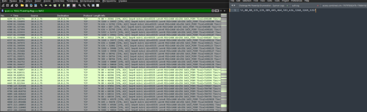
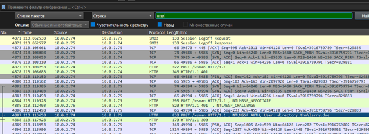
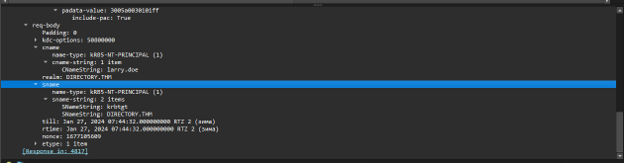
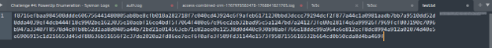
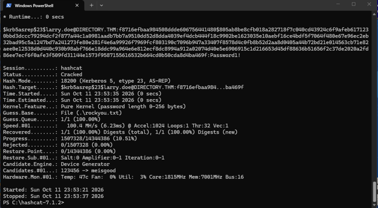
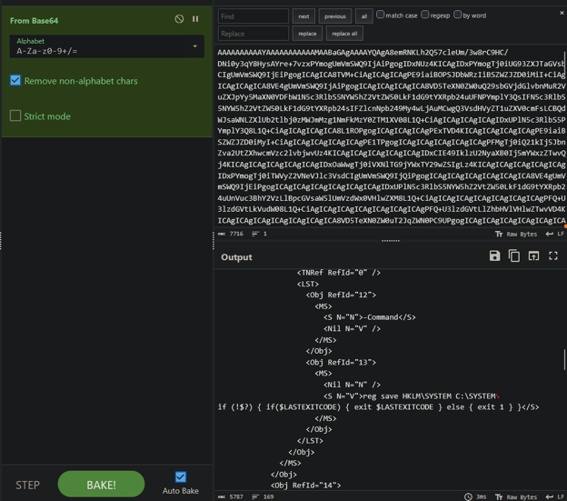
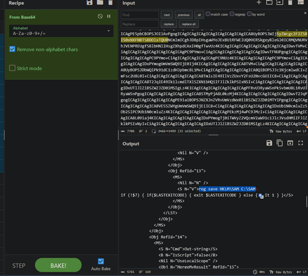

**AS-REP-Roasting-&-Credential-Access-Investigation**

**Incident Type:** Credential Access / Kerberos Abuse / Password Cracking / Credential Dumping
**Status:** Completed
**Date of Analysis:** October 12, 2026
**Environment:** CTF / SOC Simulation Exercise (Endpoint Detection & Forensic Analysis)

### Executive Summary

An investigation into a targeted network intrusion revealed the successful exploitation of a Kerberos misconfiguration, specifically an AS-REP Roasting attack. The threat actor conducted network reconnaissance to identify exposed services, targeted the user `larry.doe`, and captured a Kerberos 5 AS-REP hash. Using Hashcat and the `rockyou.txt` wordlist, the attacker successfully cracked the user's password (`Password1!`), granting initial access to the domain `DIRECTORY.THM`. 

Post-exploitation analysis of the decoded Base64 command-and-control (C2) payloads showed the attacker executing registry hive dumping commands (`reg save`) to extract the SAM and SYSTEM hives for further credential harvesting. A final flag was recovered from the compromised system, confirming the extent of the breach.

### Investigation Workflow

The investigation followed a structured forensic workflow utilizing network traffic analysis and cryptographic cracking:

1.  **Network Traffic Analysis** – Analyze Wireshark captures to identify open ports, services, and potential attack vectors.
2.  **Kerberos Protocol Analysis** – Extract and analyze Kerberos AS-REP traffic to identify vulnerable accounts.
3.  **Password Cracking** – Utilize Hashcat to crack the extracted Kerberos hash and recover plaintext credentials.
4.  **Command & Control (C2) Decoding** – Decode Base64-encoded payloads to reveal post-exploitation commands.
5.  **Flag Extraction** – Retrieve and validate the final objective flag.

---

### 1. Initial Access & Network Reconnaissance

The investigation began with the analysis of network traffic captured during the intrusion. The attacker performed network scanning, which revealed several open ports and services on the target host.

*   **Open Ports Identified:** `53, 80, 88, 135, 139, 389, 445, 464, 593, 636, 3268, 3269, 5357`
*   **Protocols Observed:** TCP, SMB, HTTP, Kerberos

*Figure 1 – Wireshark capture showing open ports and initial network traffic.*

Further analysis of the traffic identified specific user activity and SMB/HTTP negotiations involving the user `larry.doe`.

*Figure 2 – Wireshark capture highlighting SMB2 and HTTP traffic associated with the user 'larry.doe'.*

### 2. Kerberos AS-REP Roasting

The attacker identified a misconfiguration in the Kerberos implementation allowing for AS-REP Roasting. By sending an unauthenticated AS-REQ to the Domain Controller, the attacker received an AS-REP response containing a hash encrypted with the user's password.

*   **Target User:** `larry.doe`
*   **Realm:** `DIRECTORY.THM`
*   **Ticket Type:** `KRB5-NT-PRINCIPAL`

*Figure 3 – Wireshark capture showing the Kerberos AS-REP ticket details for 'larry.doe'.*

### 3. Password Cracking & Initial Foothold

With the AS-REP hash extracted, the attacker utilized Hashcat (Mode 18200) and the `rockyou.txt` wordlist to perform an offline brute-force attack. The hash was successfully cracked, revealing the user's plaintext password.

*   **Hash Mode:** `18200` (Kerberos 5, etype 23, AS-REP)
*   **Cracked Password:** `Password1!`
*   **Hashcat Command Utilized:** `hashcat -m 18200 -a 0 hash.txt rockyou.txt`

*Figure 4 – Hashcat output showing the successful cracking of the AS-REP hash for 'larry.doe'.*

### 4. Post-Exploitation & Credential Dumping

With valid credentials, the attacker established a foothold on the server and executed commands to dump credential material. Analysis of the Base64-encoded payloads in CyberChef revealed the use of `reg save` commands to extract critical registry hives.

*   **Command 1:** `reg save HKLM\SYSTEM C:\SYSTEM`
*   **Command 2:** `reg save HKLM\SAM C:\SAM`

*Figure 5 – CyberChef decoding of the Base64 payload revealing the 'reg save HKLM\SYSTEM' command.*

*Figure 6 – CyberChef decoding of the Base64 payload revealing the 'reg save HKLM\SAM' command.*

### 5. Flag Extraction

The attacker successfully exfiltrated the SAM and SYSTEM hives, which would allow for offline extraction of local NTLM hashes. The final objective flag was retrieved from the system, confirming the complete compromise of the host.

*   **Decoded Flag:** `THM{Ya_G0t_R0aSt3d!}`

*Figure 7 – Answer key validation confirming the extracted ports, username, hash suffix, password, commands, and flag.*

---

### Indicators of Compromise (IoCs)

**Host & Identity Indicators**
| Type | Value |
| :--- | :--- |
| Target User | `directory.thm\larry.doe` |
| Cracked Password | `Password1!` |
| Open Ports | `53, 80, 88, 135, 139, 389, 445, 464, 593, 636, 3268, 3269, 5357` |
| Kerberos Realm | `DIRECTORY.THM` |

**Tool & Artifact Indicators**
| Type | Value |
| :--- | :--- |
| Hash Type | `$krb5asrep$23$larry.doe@DIRECTORY.THM...` |
| Last 30 Characters of Hash | `55616532b664cd0b50cda8d4ba469f` |
| Executed Commands | `reg save HKLM\SYSTEM C:\SYSTEM`, `reg save HKLM\SAM C:\SAM` |
| Flag | `THM{Ya_G0t_R0aSt3d!}` |

---

### MITRE ATT&CK Mapping

| Technique | ID | Description |
| :--- | :--- | :--- |
| Network Service Scanning | T1046 | Scanning for open ports and services (e.g., 53, 80, 88, 445). |
| Steal or Forge Kerberos Tickets: AS-REP Roasting | T1558.004 | Capturing Kerberos AS-REP hashes for offline cracking. |
| Brute Force: Password Cracking | T1110.002 | Cracking the AS-REP hash using Hashcat and `rockyou.txt`. |
| OS Credential Dumping: Security Account Manager | T1003.002 | Extracting the SAM hive using `reg save`. |
| OS Credential Dumping: Local Security Authority Subsystem Service (LSASS) | T1003.001 | Extracting the SYSTEM hive to decrypt SAM hashes. |
| Command and Scripting Interpreter: Windows Command Shell | T1059.003 | Execution of `reg save` commands via C2. |

---

### Conclusion & Recommendations

The investigation confirmed that the host was compromised through an AS-REP Roasting attack targeting a misconfigured Kerberos account. The attacker successfully cracked the user's password, gained a foothold, and executed registry dumping commands to extract credential hashes for further lateral movement. The recovery of the flag indicates a complete compromise of the target system.

**Recommendations:**

1.  **Kerberos Security Hardening** – Disable "Do not require Kerberos preauthentication" for all user accounts. Enforce strong, complex passwords to mitigate the effectiveness of offline cracking.
2.  **Account Security** – Implement Multi-Factor Authentication (MFA) across all domain accounts. Monitor for anomalous Kerberos ticket requests (Event ID 4768) originating from unusual sources.
3.  **Endpoint Detection & Response (EDR)** – Monitor for the execution of `reg save` commands, particularly targeting SAM and SYSTEM hives. Block unauthorized access to registry hives.
4.  **Network Monitoring** – Restrict unnecessary open ports and implement network segmentation. Monitor SMB and Kerberos traffic for anomalous patterns indicative of reconnaissance or credential dumping.
5.  **Incident Response Playbook** – Update IR playbooks to include procedures for detecting AS-REP Roasting, analyzing Kerberos traffic, and responding to credential dumping attempts via `reg save`.