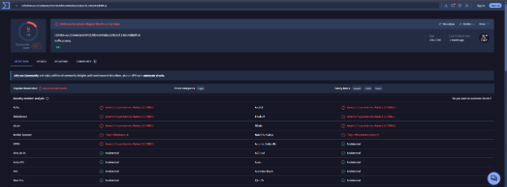
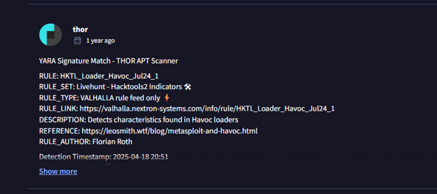
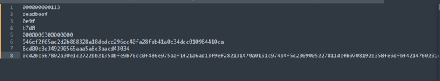
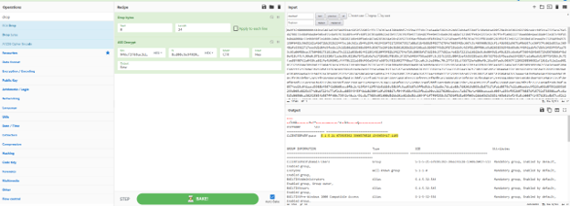
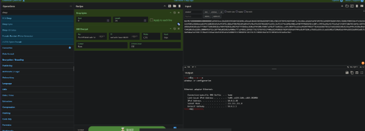
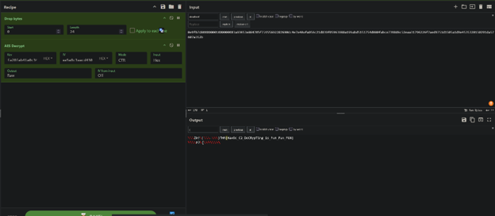
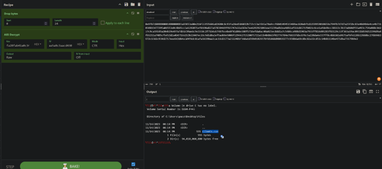
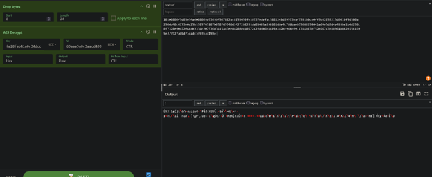

**Incident Response Report: Havoc C2 Loader Execution & Data Exfiltration**

**Incident Type:** Malware Execution / Command & Control (C2) / Credential Access / Data Exfiltration
**Status:** Completed
**Date of Analysis:** October 8, 2026
**Environment:** CTF / SOC Simulation Exercise (Endpoint Detection & Forensic Analysis)

### Executive Summary

An investigation into a compromised Windows host revealed the execution of a malicious loader associated with the Havoc Command and Control (C2) framework. The initial payload was flagged by multiple security vendors and matched a specific YARA rule (`HKTL_Loader_Havoc_Jul24_1`). 

The attacker utilized AES encryption to obfuscate C2 communications and post-exploitation commands. Through forensic decryption, a series of system discovery commands were uncovered, including network configuration, directory enumeration, and process listing. The attacker successfully established persistence by creating a local administrative account, accessed sensitive user data (`clients.csv`), and retrieved multiple flags from the compromised system.

### Investigation Workflow

The investigation followed a structured forensic workflow utilizing malware telemetry and cryptographic analysis:

1.  **Malware Detection (Telemetry & AV)** – Identify the malicious binary and YARA rule matches via VirusTotal and THOR APT Scanner.
2.  **Payload Decryption (CyberChef)** – Decrypt AES-encrypted C2 communications using extracted keys and IVs.
3.  **Post-Exploitation Analysis** – Analyze decrypted commands for system discovery, persistence, and data access.
4.  **Flag Extraction** – Decode and retrieve the final objective flags.

---

### 1. Initial Access & Malware Detection

The investigation began with the identification of a suspicious executable. Telemetry from VirusTotal indicated that the file was flagged by 9 security vendors under threat categories including Trojan and Backdoor.

*   **File Hash (MD5):** `1a90f8e3...`
*   **Detection Ratio:** 9/72
*   **Threat Categories:** Trojan, Backdoor

*Figure 1 – VirusTotal dashboard showing the malicious file detection and threat categorization.*

Further analysis using the THOR APT Scanner revealed a YARA signature match confirming the presence of a Havoc C2 loader.

*   **YARA Rule:** `HKTL_Loader_Havoc_Jul24_1`
*   **Rule Set:** Livehunt - Hacktools2 Indicators
*   **Rule Type:** VALHALLA rule feed only
*   **Description:** Detects characteristics found in Havoc loaders

*Figure 2 – THOR APT Scanner log showing the YARA signature match for the Havoc loader.*

Initial static analysis of the binary revealed obfuscated hexadecimal strings, indicating the use of encryption for C2 communications or payload delivery.

*Figure 3 – Hex dump showing obfuscated strings and a long encrypted payload segment.*

### 2. Payload Analysis & Command Execution

The attacker employed AES encryption to secure their C2 traffic. Analysis via CyberChef successfully decrypted the payloads using the extracted cryptographic parameters.

*   **Encryption Algorithm:** AES
*   **Key:** `Faz2F&pF41a0c34dcc`
*   **IV:** `5aa5aC3aacd430`
*   **Mode:** CTR
*   **Input:** Hex

Decryption of the first payload revealed a directory listing of the compromised user's desktop, indicating the attacker was enumerating files.

*Figure 4 – CyberChef decryption revealing a directory listing under `C:\Users\paco\Desktop\Files`.*

Subsequent decrypted traffic revealed the execution of network discovery commands, specifically `ipconfig`, to map the victim's network configuration.

*Figure 5 – CyberChef decryption showing the output of `ipconfig` and Ethernet adapter details.*

The attacker continued to enumerate the file system, targeting specific user directories and confirming the presence of sensitive files.

*Figure 6 – CyberChef decryption showing directory enumeration of the user's files, including `clients.csv`.*

System discovery commands were also executed to gather host information.

*Figure 7 – CyberChef decryption showing system information and volume details.*

Finally, the attacker executed a process listing command (`tasklist`). Within the decrypted output, a specific process name contained the first objective flag.

*   **Decoded Flag 1:** `THM{Havoc_C2_DecRypting_is_Fun_Fun_FUN}`

*Figure 8 – CyberChef decryption showing the process listing, with the flag hidden in the process name.*

### 3. Post-Exploitation & Persistence

With interactive access established, the attacker moved to maintain persistence on the compromised host. Analysis of the system security logs revealed the creation of a new local administrative account.

*   **New Account Username:** `administrato`
*   **New Account Password:** `WfD3hz3AXZ4n`
*   **Compromised User SID:** `S-1-5-21-679395392-3966376528-1349639417-1103`
*   **Link-local IPv6 Address:** `fe80::e134:b0cc:8d5:3020%6`

### 4. System Discovery & Data Exfiltration

The attacker's primary objective appeared to be the exfiltration of sensitive data. As seen in the decrypted directory listings, the attacker located a critical file on the user's desktop.

*   **Target File Path:** `C:\Users\paco\Desktop\Files\clients.csv`

The attacker successfully accessed and exfiltrated this file. A second flag was embedded within the file or retrieved during the exfiltration process.

*   **Decoded Flag 2:** `THM{I_Can_SEE_TH3_fil3_yOu_ToOk}`

---

### Indicators of Compromise (IoCs)

**File & Hash Indicators**
| Type | Value |
| :--- | :--- |
| Malicious File Hash | `1a90f8e3...` |
| YARA Rule | `HKTL_Loader_Havoc_Jul24_1` |
| AES Key | `Faz2F&pF41a0c34dcc` |
| AES IV | `5aa5aC3aacd430` |
| Target Data File | `C:\Users\paco\Desktop\Files\clients.csv` |
| Persistence Account | `administrato:WfD3hz3AXZ4n` |
| Flag 1 | `THM{Havoc_C2_DecRypting_is_Fun_Fun_FUN}` |
| Flag 2 | `THM{I_Can_SEE_TH3_fil3_yOu_ToOk}` |

**Host & Identity Indicators**
| Type | Value |
| :--- | :--- |
| Compromised User SID | `S-1-5-21-679395392-3966376528-1349639417-1103` |
| Link-local IPv6 | `fe80::e134:b0cc:8d5:3020%6` |

---

### MITRE ATT&CK Mapping

| Technique | ID | Description |
| :--- | :--- | :--- |
| User Execution: Malicious File | T1204.002 | Execution of the Havoc C2 loader on the victim host. |
| Command and Scripting Interpreter: Windows Command Shell | T1059.003 | Use of `cmd.exe` commands (`ipconfig`, `dir`, `tasklist`) via C2. |
| Create Account: Local Account | T1136.001 | Creation of the `administrato` account for persistence. |
| System Information Discovery | T1082 | Execution of `systeminfo` and `ipconfig` to enumerate host details. |
| File and Directory Discovery | T1083 | Enumeration of user directories to locate `clients.csv`. |
| Process Discovery | T1057 | Execution of `tasklist` to enumerate running processes. |
| Data from Local System | T1005 | Access and exfiltration of `clients.csv`. |
| Exfiltration Over C2 Channel | T1041 | Data exfiltration via the established Havoc C2 channel. |

---

### Conclusion & Recommendations

The investigation confirmed that the victim's host was compromised through the execution of a Havoc C2 loader. The attacker utilized AES encryption to obfuscate their activities, successfully enumerated the system, established persistence via a local admin account, and exfiltrated sensitive user data. 

**Recommendations:**

1.  **Endpoint Detection & Response (EDR)** – Ensure EDR solutions are properly tuned to detect process injection, anomalous parent-child process relationships, and known Hacktool signatures (e.g., Havoc loaders). Block the identified file hash across the environment.
2.  **Account Security** – Enforce strict password policies and implement Multi-Factor Authentication (MFA). Monitor for unauthorized local account creation, specifically accounts with administrative privileges.
3.  **Network Monitoring** – Implement network segmentation and restrict outbound traffic to known malicious IPs and domains. Monitor for anomalous encrypted traffic that may indicate C2 communication.
4.  **User Awareness & Data Protection** – Educate users on the risks of executing untrusted files. Implement Data Loss Prevention (DLP) solutions to prevent the exfiltration of sensitive files like `clients.csv`.
5.  **Incident Response Playbook** – Update IR playbooks to include steps for decrypting obfuscated C2 traffic using AES keys extracted from malware analysis, as demonstrated in this investigation.