**Insider-Threat-&-Credential-Access-Investigation**

**Incident Type:** Insider Threat / Credential Access / Privilege Escalation / Data Exfiltration
**Status:** Completed
**Date of Analysis:** October 10, 2026
**Environment:** CTF / SOC Simulation Exercise (Endpoint Detection & Forensic Analysis)

### Executive Summary

An investigation into a compromised Windows host, designated `DESKTOP-0R59DJ3`, revealed malicious internal activity involving credential dumping tools and privilege escalation exploits. The forensic analysis of the disk image (`HASAN2.E01`) uncovered evidence of PowerShell weaponization, the presence of credential harvesting tools like Mimikatz and LaZagne, and reconnaissance utilities such as Look@LAN. 

The attacker successfully enumerated local user accounts, established persistence mechanisms via registry modifications and scheduled tasks, and targeted specific user directories. The investigation also identified attempts to exfiltrate data and deploy a Zerologon (MS-NRPC) exploit against a domain controller. Multiple flags and user-specific artifacts were recovered from the compromised system.

### Investigation Workflow

The investigation followed a structured forensic workflow utilizing disk image analysis and artifact correlation:

1.  **Image Verification & System Identification** – Identify the host, OS version, and hardware configuration.
2.  **User & Account Enumeration** – Extract local user accounts, SIDs, and identify the last logged-in user.
3.  **Network & Software Discovery** – Analyze network configurations, installed software, and reconnaissance tools.
4.  **User Activity & Exploit Artifacts** – Analyze PowerShell history, registry modifications, and user file artifacts.
5.  **Credential Dumping Tools Analysis** – Identify and analyze tools used for credential harvesting (Mimikatz, LaZagne) and privilege escalation (Zerologon).

---

### 1. Initial Access & System Information

The investigation began with the forensic imaging and verification of the compromised host.

*   **Image Name:** `/img_HASAN2.E01`
*   **Image MD5:** `3f08c518adb3b5c1359849657a9b2079`
*   **Device ID:** `bc9efb0d-bb21-4d04-a08f-3c169ea67774`
*   **Timezone:** `America/New_York`

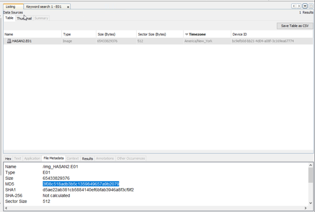

*Figure 1 – File metadata of the E01 image used for forensic analysis.*

Further analysis of the operating system information revealed the host details and architecture.

*   **Hostname:** `DESKTOP-0R59DJ3`
*   **Domain:** `DESKTOP-0R59DJ3`
*   **OS Version:** `Windows_NT`
*   **Processor Architecture:** `AMD64`

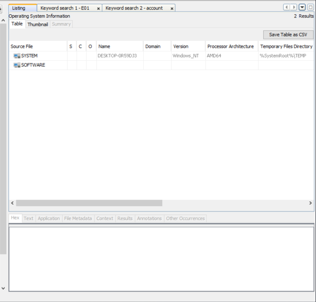

*Figure 2 – Extracted operating system information from SYSTEM and SOFTWARE registry hives.*

### 2. User Enumeration & Account Analysis

Analysis of the SAM (Security Account Manager) and SOFTWARE registry hives revealed multiple local user accounts. The attacker's focus on specific accounts indicated targeted reconnaissance.

*   **User Accounts:** `keshav`, `sivapriya`, `sandhya`, `srini`, `H4S4N`, `joshwa`, `Administrator`, `suba`, `Guest`, `shreya`, `DefaultAccount`, `WDAGUtilityAccount`, `systemprofile`, `LocalService`, `NetworkService`
*   **Last Logged-in User:** `sivapriya` (Last Accessed: 2021-02-07 12:05:37 EST)
*   **Most Active Suspect Account:** `H4S4N` (Associated with credential dumping tools)

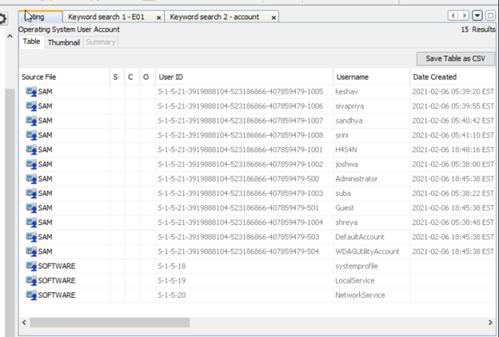

*Figure 3 – Operating System User Account details extracted from SAM and SOFTWARE hives.*

The user paths were mapped to identify the directory structure and targeted users.

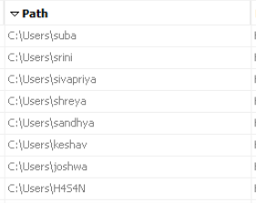

*Figure 4 – List of user directories indicating local profiles.*

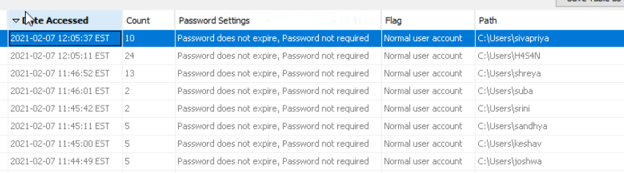

*Figure 5 – User access times and account flags, highlighting the most recently accessed accounts.*

### 3. Network & Software Discovery

The attacker utilized built-in and third-party tools to map the network and identify the system's configuration.

*   **IP Address:** `192.168.130.216`
*   **MAC Address:** `08:00:27:2c:c4:b9`
*   **Network Card:** `Intel(R) PRO/1000 MT Desktop Adapter`
*   **Reconnaissance Tool:** `Look@LAN`

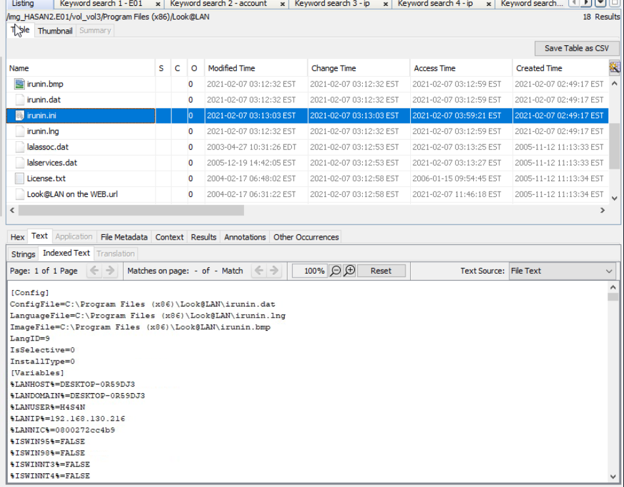

*Figure 6 – Configuration file of Look@LAN showing network variables and host details.*

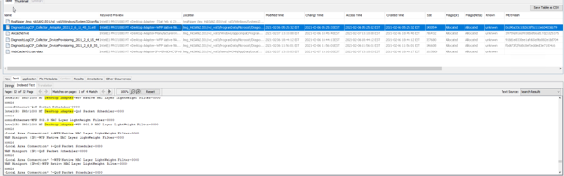

*Figure 7 – Registry keyword search results for IP-related artifacts.*

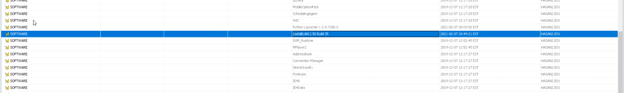

*Figure 8 – Installed software listing from the SOFTWARE registry hive.*

### 4. User Activity & Exploitation Artifacts

Analysis of user artifacts revealed specific activities related to reconnaissance, data manipulation, and privilege escalation.

*   **Google Maps Location:** `12°52'23.0"N 80°13'25.0"E`
*   **User Full Name:** `Anto Joshwa` (Identified from desktop wallpaper)
*   **Targeted User:** `shreya`
*   **First Flag:** `flag{HarleyQuinnForQueen}`
*   **Second Flag:** `flag{I-hacked-you}`

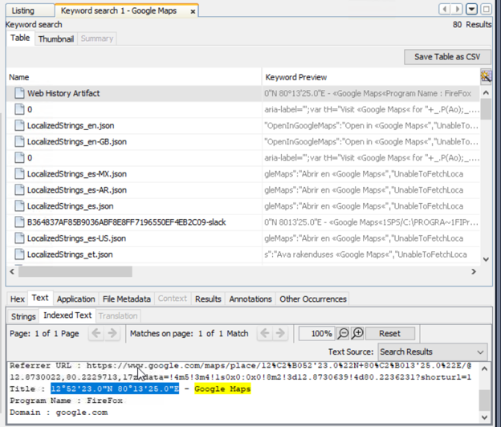

*Figure 9 – Google Maps location artifact retrieved from user's web history.*

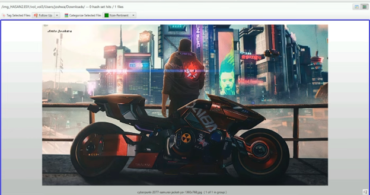

*Figure 10 – User's desktop wallpaper revealing the full name "Anto Joshwa".*

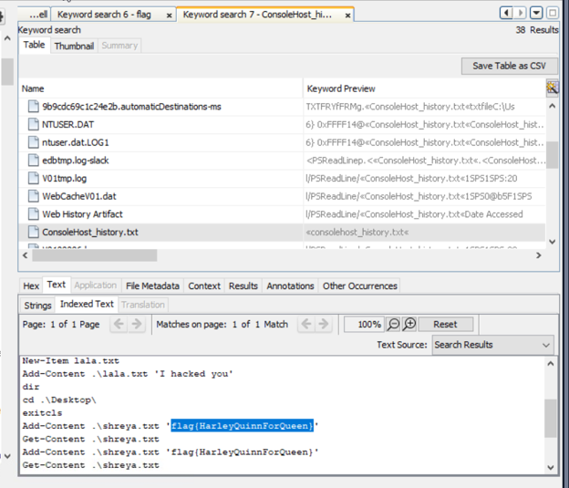

*Figure 11 – ConsoleHost_history.txt showing PowerShell commands used to create files and manipulate flags.*

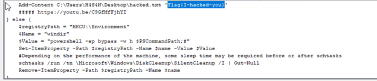

*Figure 12 – PowerShell script demonstrating an attempt to abuse the SilentCleanup scheduled task for UAC bypass and registry modification.*

### 5. Credential Dumping & Privilege Escalation Tools

The attacker deployed specialized tools to harvest credentials and exploit the domain controller. Prefetch files, direct file execution artifacts, and tool directories confirmed the execution of these tools.

*   **Credential Dumping Tools:** `LaZagne`, `Mimikatz`
*   **Exploit Tool:** `Zerologon` (MS-NRPC based exploit)

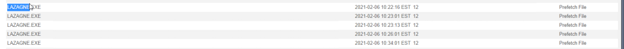

*Figure 13 – Prefetch files indicating the execution of LAZAGNE.EXE.*

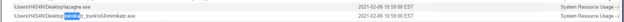

*Figure 14 – File execution artifacts showing paths and timestamps for LaZagne and Mimikatz on the user's desktop.*

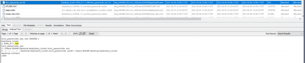

*Figure 15 – Mimikatz trunk directory and kiwi_passwords.yar file, indicating credential dumping activity.*

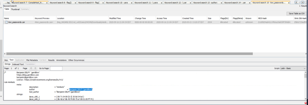

*Figure 16 – YARA rule file authored by Benjamin DELPY (gentilkiwi), confirming the presence of Mimikatz.*

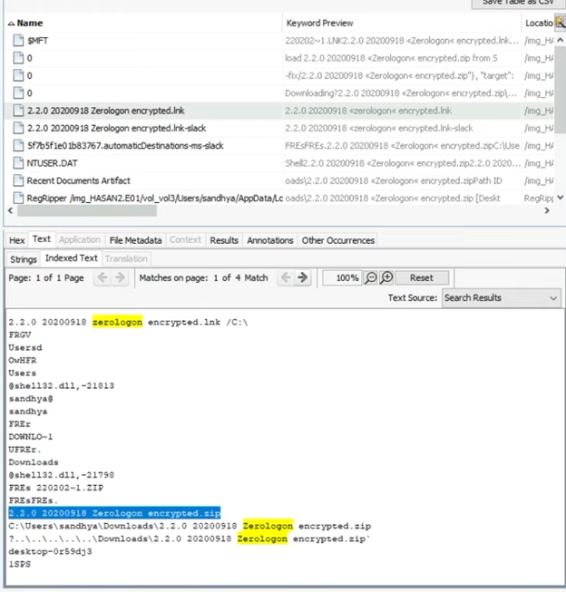

*Figure 17 – Link file and archive indicating the download and potential use of the Zerologon exploit.*

---

### Indicators of Compromise (IoCs)

**Host & Identity Indicators**
| Type | Value |
| :--- | :--- |
| Image MD5 | `3f08c518adb3b5c1359849657a9b2079` |
| Hostname | `DESKTOP-0R59DJ3` |
| IP Address | `192.168.130.216` |
| MAC Address | `08:00:27:2c:c4:b9` |
| Primary User | `H4S4N` |
| Last Logged-in User | `sivapriya` |
| Target User | `shreya` |

**Tool & Artifact Indicators**
| Type | Value |
| :--- | :--- |
| Network Tool | `Look@LAN` |
| Credential Dumper | `LaZagne`, `Mimikatz` |
| Exploit Archive | `2.2.0 20200918 Zerologon encrypted.zip` |
| YARA Author | `Benjamin DELPY (gentilkiwi)` |
| Flag 1 | `flag{HarleyQuinnForQueen}` |
| Flag 2 | `flag{I-hacked-you}` |

---

### MITRE ATT&CK Mapping

| Technique | ID | Description |
| :--- | :--- | :--- |
| Command and Scripting Interpreter: PowerShell | T1059.001 | Use of PowerShell for file manipulation and privilege escalation. |
| Exploitation for Privilege Escalation | T1068 | Use of Zerologon exploit to target domain controllers. |
| OS Credential Dumping | T1003 | Use of Mimikatz and LaZagne to extract credentials. |
| Account Discovery: Local Account | T1087.001 | Enumeration of local user accounts via SAM/SOFTWARE hives. |
| System Network Configuration Discovery | T1016 | Use of `ipconfig` and network tools to map the environment. |
| Bypass User Account Control | T1548.002 | Abuse of the SilentCleanup scheduled task to bypass UAC. |
| Data from Local System | T1005 | Access and manipulation of user files (`shreya.txt`, `hacked.txt`). |

---

### Conclusion & Recommendations

The investigation confirmed that the host `DESKTOP-0R59DJ3` was compromised by an attacker utilizing credential dumping tools and privilege escalation exploits. The attacker successfully enumerated local users, deployed Mimikatz and LaZagne, and executed PowerShell scripts to manipulate data and establish persistence. The presence of the Zerologon exploit indicates an intent to compromise the broader network, specifically domain controllers.

**Recommendations:**

1.  **Endpoint Detection & Response (EDR)** – Ensure EDR solutions are tuned to detect known Hacktool signatures (e.g., Mimikatz, LaZagne) and anomalous PowerShell execution. Block the identified tools and their hashes across the environment.
2.  **Account Security** – Enforce strict password policies and implement Multi-Factor Authentication (MFA). Monitor for unauthorized local account creation and unusual access patterns.
3.  **Network Monitoring** – Restrict outbound traffic and monitor for anomalous encrypted traffic. Block the use of unauthorized network discovery tools like Look@LAN.
4.  **User Awareness & Data Protection** – Educate users on the risks of executing untrusted scripts. Implement Data Loss Prevention (DLP) solutions to prevent the exfiltration of sensitive files and flags.
5.  **Incident Response Playbook** – Update IR playbooks to include steps for analyzing PowerShell history, prefetch files, and registry modifications to identify credential dumping and privilege escalation attempts.